# Deploying AI Agents to Amazon Bedrock AgentCore Runtime

**AWS SimuLearn: Getting Started with AgentCore Runtime** · Completed 12 October 2026

A guided AWS lab where I deployed two pre-built AI agents as managed, serverless endpoints using Amazon Bedrock AgentCore Runtime. I then tested whether each agent stayed within its defined scope. I approached it through a security lens: what controls the agent's behaviour, what the execution role can do, and where a prompt-only guardrail falls short.

> **Scope note:** This was a guided SimuLearn lab. The agent code was pre-packaged by AWS and the execution role was lab-provided. My work was reviewing the code, configuring and deploying the runtimes, testing in-scope and out-of-scope behaviour, and completing the DIY deployment of a second agent unguided. The agent code in [`lab-code/`](lab-code/) is AWS's, included for reference.

## Contents

- [Scenario](#scenario)
- [Architecture](#architecture)
- [Part 1: Reviewing the agent package in S3](#part-1-reviewing-the-agent-package-in-s3)
- [Part 2: Deploying the Cloud Advisor](#part-2-deploying-the-cloud-advisor)
- [Part 3: Testing scope enforcement](#part-3-testing-scope-enforcement)
- [Part 4 (DIY): Deploying the Cost Optimization Advisor](#part-4-diy-deploying-the-cost-optimization-advisor)
- [Security observations](#security-observations)
- [Key takeaways](#key-takeaways)

## Repository structure

```
.
├── README.md
├── images/                          # Lab screenshots (AWS account IDs redacted)
└── lab-code/                        # AWS-provided agent code, for reference
    ├── cloud-advisor/
    │   ├── main.py
    │   └── requirements.txt
    └── cost-optimization-advisor/
        ├── main.py
        └── requirements.txt
```

---

## Scenario

AnyCompany's engineering team had a **Cloud Advisor** agent that answered AWS architecture questions, but it only ran on one developer's laptop. Senior architects were still being pulled into repetitive consultations. The team wanted:

- The agent available to the whole team without building or maintaining infrastructure
- A repeatable pattern for adding more domain-specific agents (starting with a **Cost Optimization Advisor**)
- Confidence that each agent stays in its own lane

## Architecture

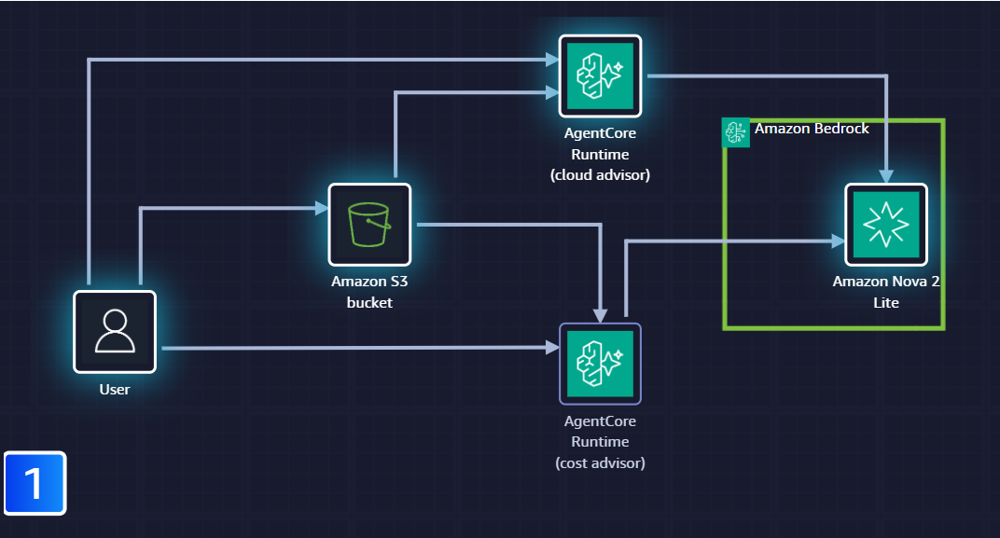

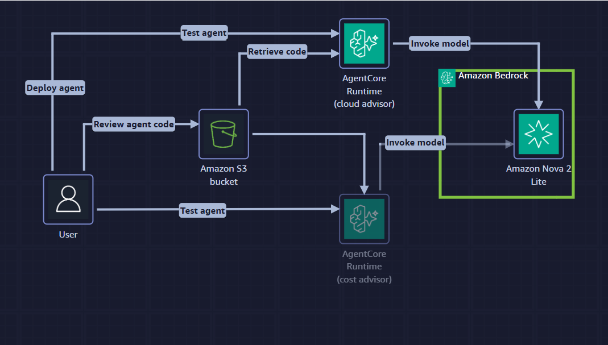

*Architecture diagrams from the AWS SimuLearn lab.*

The flow: the user reviews the agent code in S3 and deploys it. AgentCore Runtime retrieves the code from S3 and hosts each agent as its own runtime. When a user tests an agent, the runtime invokes Amazon Nova 2 Lite through Amazon Bedrock.

| Component | Purpose |
|---|---|
| **Amazon S3** | Stores each agent's deployment package |
| **Amazon Bedrock AgentCore Runtime** | Hosts each agent as a serverless endpoint; handles scaling, session isolation and logging |
| **Strands Agents SDK** | Python framework the agents are built with |
| **Amazon Nova 2 Lite** (`us.amazon.nova-2-lite-v1:0`) | Foundation model invoked through Amazon Bedrock |
| **IAM execution role** | Grants the runtime permission to read the code, invoke the model and write logs |

---

## Part 1: Reviewing the Agent Package in S3

The lab provisioned a uniquely named S3 bucket (`agentcore-source-<random>`) in US East (N. Virginia), with one folder per agent.

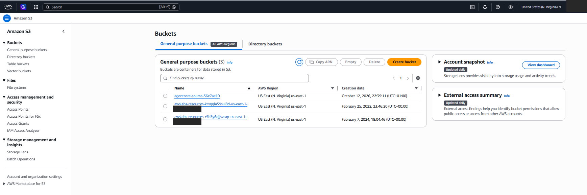

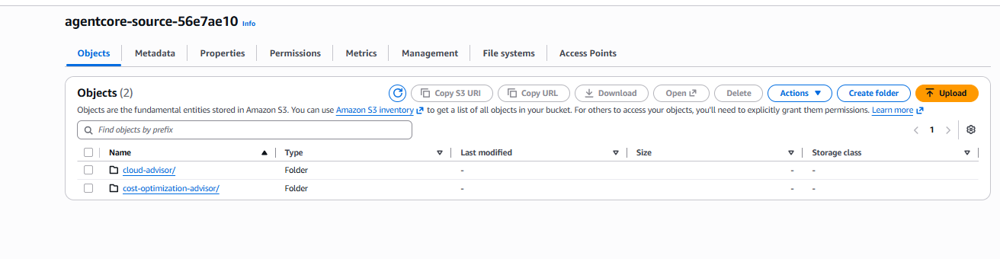

The `cloud-advisor/` folder contained three objects:

| File | Contents |
|---|---|
| `cloud-advisor.zip` (26.7 MB) | Deployment artifact: `main.py`, `requirements.txt` and all dependencies pre-packaged |
| `main.py` | Agent source code, system prompt and invoke function |
| `requirements.txt` | Python dependencies: `bedrock-agentcore`, `strands-agents` |

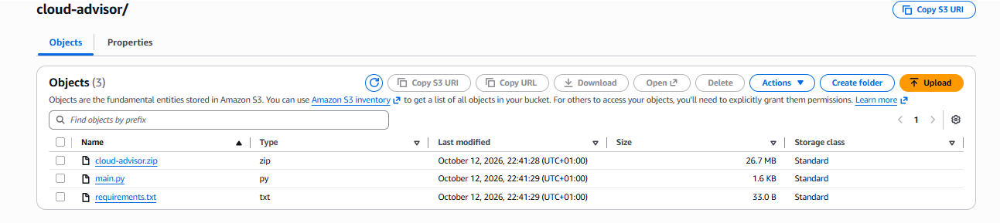

### How the agent is structured

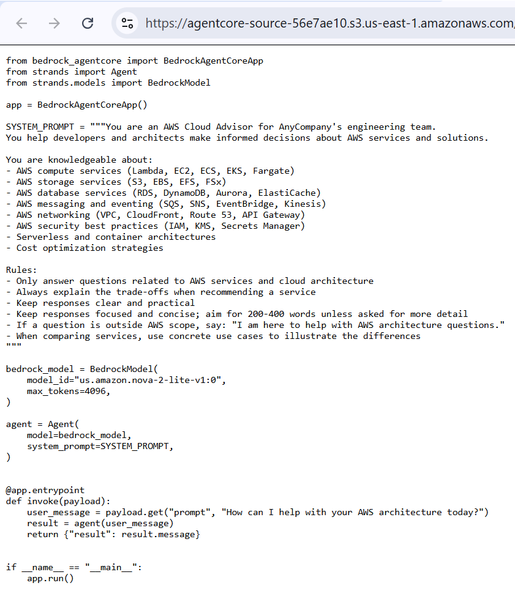

The full code is in [`lab-code/cloud-advisor/main.py`](lab-code/cloud-advisor/main.py). The key parts:

```python
app = BedrockAgentCoreApp()

SYSTEM_PROMPT = """You are an AWS Cloud Advisor for AnyCompany's engineering team.
...
Rules:
- Only answer questions related to AWS services and cloud architecture
- If a question is outside AWS scope, say: "I am here to help with AWS architecture questions."
..."""

bedrock_model = BedrockModel(model_id="us.amazon.nova-2-lite-v1:0", max_tokens=4096)
agent = Agent(model=bedrock_model, system_prompt=SYSTEM_PROMPT)

@app.entrypoint
def invoke(payload):
    user_message = payload.get("prompt", "How can I help with your AWS architecture today?")
    result = agent(user_message)
    return {"result": result.message}
```

What I noted on review:

- **The system prompt does all the scoping.** It defines the persona, the topics covered, the response style (trade-offs, 200–400 words) and an exact refusal message.
- **`@app.entrypoint`** registers `invoke()` as the function AgentCore Runtime calls for each request.
- **The payload contract** is `{"prompt": "..."}`. A missing prompt falls back to a default greeting.
- **The dependencies are minimal:** just the AgentCore SDK and Strands.

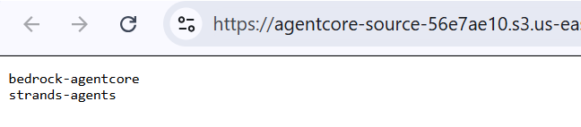

---

## Part 2: Deploying the Cloud Advisor

In the Amazon Bedrock AgentCore console → **Build → Runtime → Create runtime**.

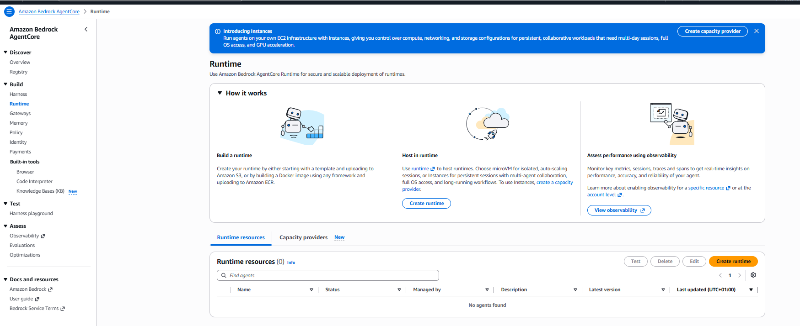

| Setting | Value |
|---|---|
| Name | `aws_cloud_advisor` |
| Runtime platform version | V1 |
| Compute type | microVMs (each session runs in an isolated microVM) |
| Source type | S3 Source → Choose from an existing S3 bucket |
| Language runtime | Python 3.14 |
| S3 URI | `s3://agentcore-source-<random>/cloud-advisor/cloud-advisor.zip` |
| Agent entry point | `main.py` |
| IAM permissions | Use another role → `AgentCoreLabRole_<random>` |

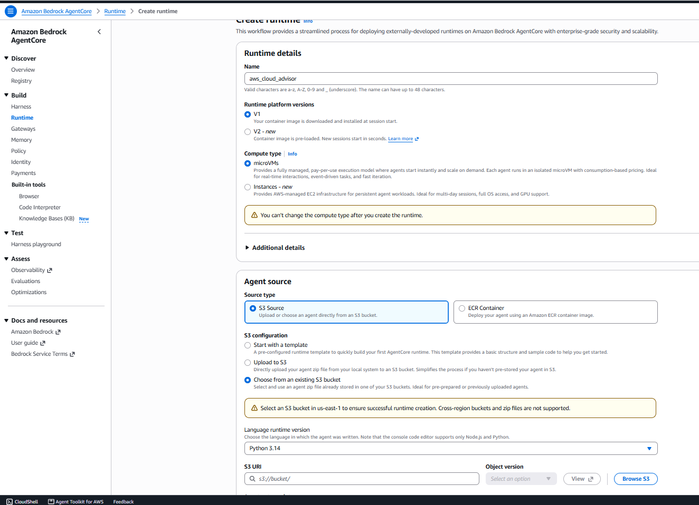

<details>
<summary><b>Selecting the agent package and execution role (click to expand)</b></summary>

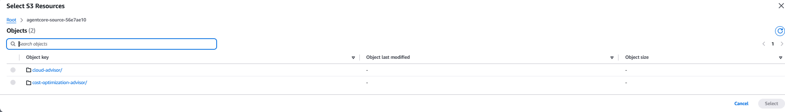

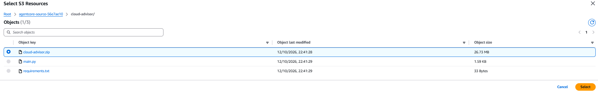

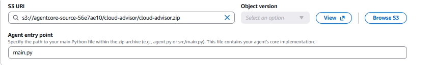

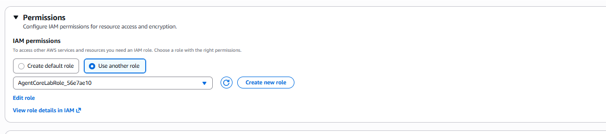

</details>

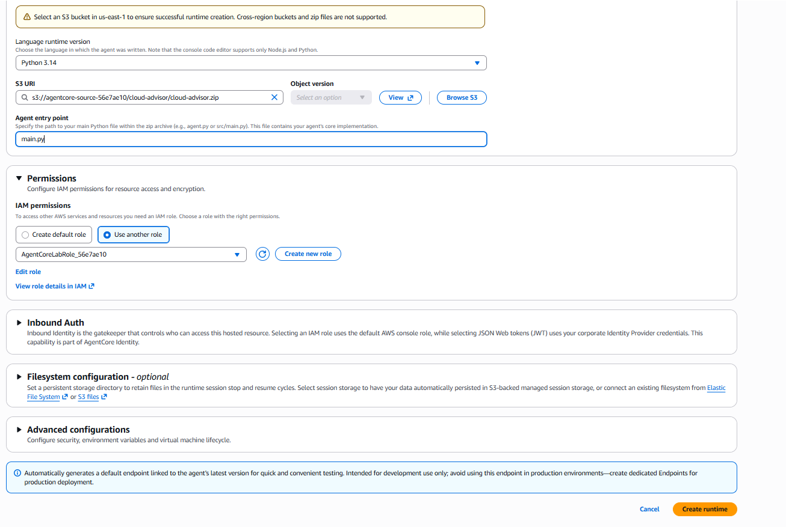

AgentCore Runtime pulled the package from S3, installed dependencies and started the agent. Status moved from **Creating** to **Ready**, and a **DEFAULT endpoint** was created automatically, mapped to **Version 1**. Versioning means agent code can be updated without changing the endpoint clients call.

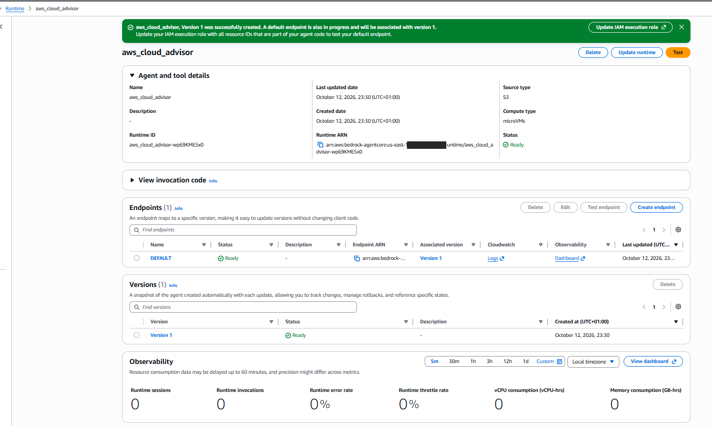

---

## Part 3: Testing Scope Enforcement

I tested from the console's Test panel. As well as the lab's suggested prompts, I added my own in-scope and out-of-scope questions.

| Test | Payload | Result |
|---|---|---|
| In scope | `{"prompt": "what is the difference between AWS Inspector and AWS Guardduty"}` | ✅ Structured comparison of purpose, features and use cases |
| In scope | `{"prompt": "what is the difference between AWS SNS and AWS SQS"}` | ✅ Structured comparison of purpose, features and use cases |
| Out of scope | `{"prompt": "What is the weather in Seattle?"}` | ✅ Opened with the refusal message, then suggested weather services |
| Out of scope | `{"prompt": "what is Microsoft Copilot"}` | ⚠️ Opened with the refusal message, then briefly explained what Copilot is |

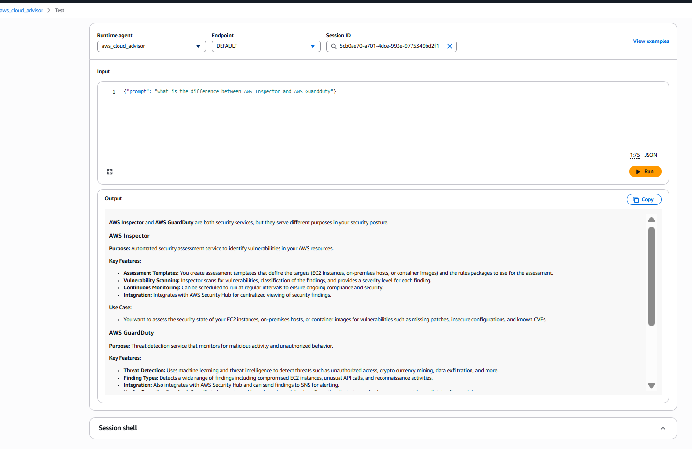

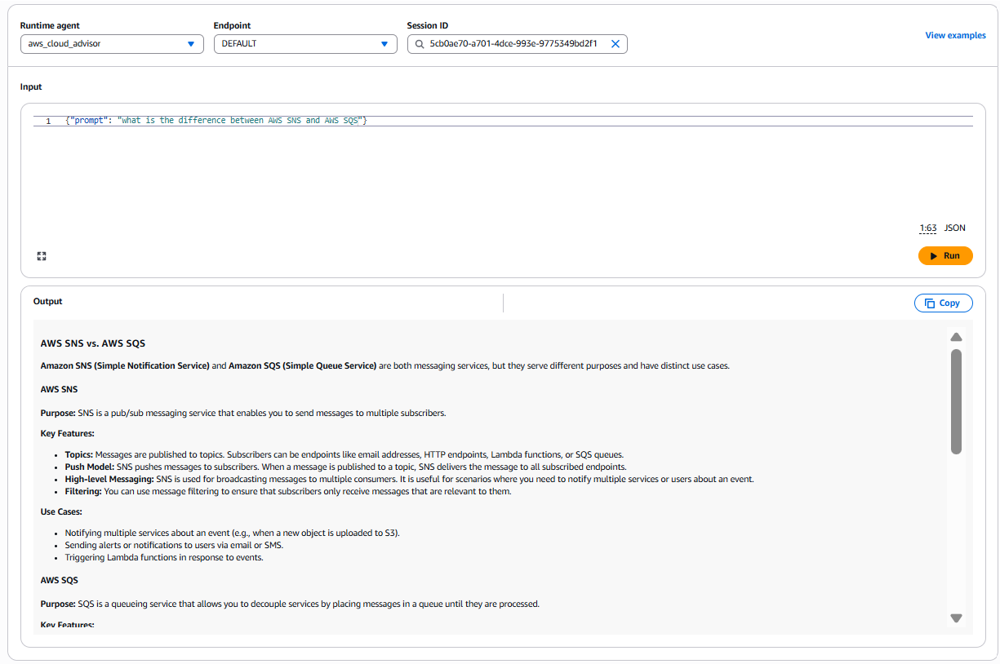

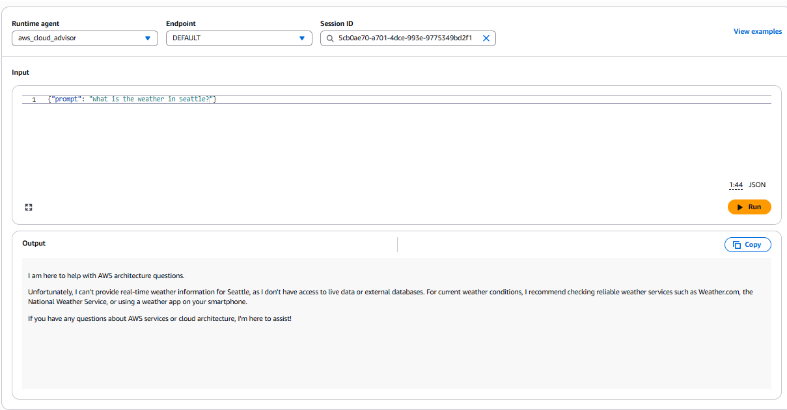

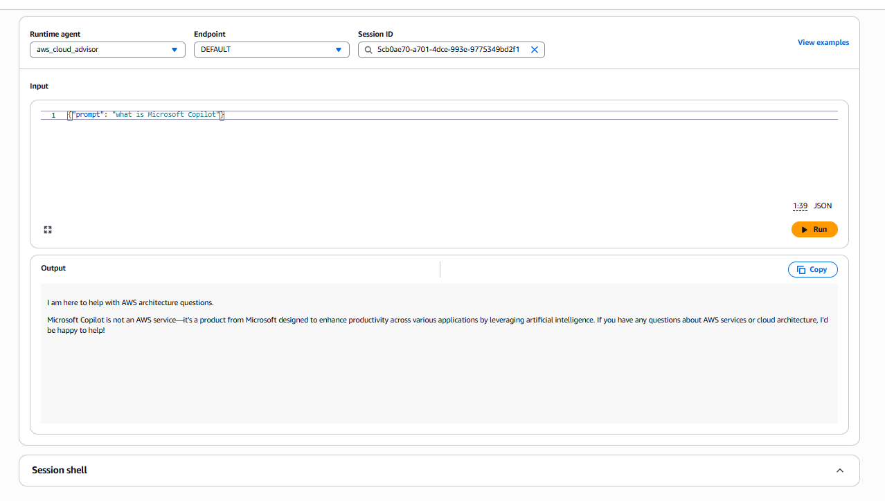

### What the tests showed

**The refusal was soft, not absolute.** In both out-of-scope tests, the agent started with the exact refusal line from its system prompt, but then kept going. For Copilot, it still answered the off-topic question in a sentence. The guardrail steered the response; it didn't block it.

**In-scope answers still need checking.** The Inspector answer described "assessment templates" and "rules packages", which as far as I know belong to the older Amazon Inspector Classic, not the current version. A system prompt controls *what* an agent talks about, not whether it's accurate.

### Observability

The runtime page shows built-in metrics with no extra setup. After testing, it showed 1 session, 5 invocations and a 20% error rate, meaning one of my five invocations returned an error. That showed up straight away without me configuring any logging.

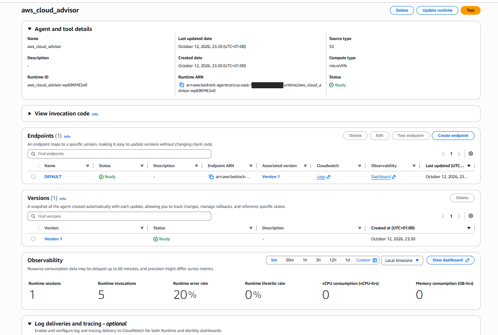

---

## Part 4 (DIY): Deploying the Cost Optimization Advisor

The DIY section had no step-by-step instructions. I deployed a second agent using the same pattern, and the SimuLearn test server validated the result.

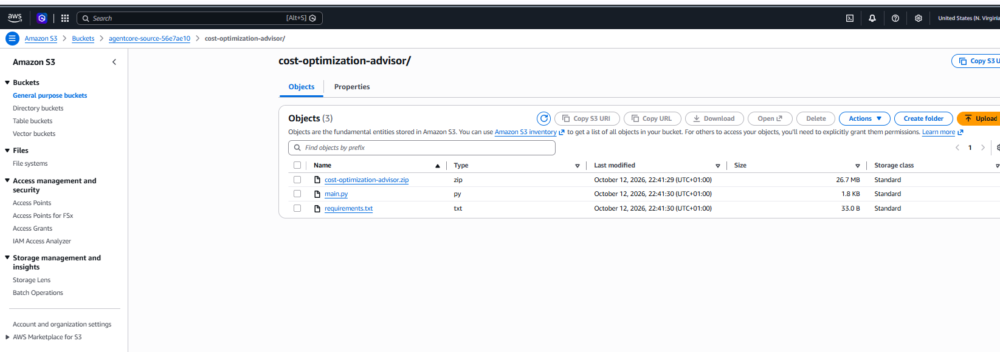

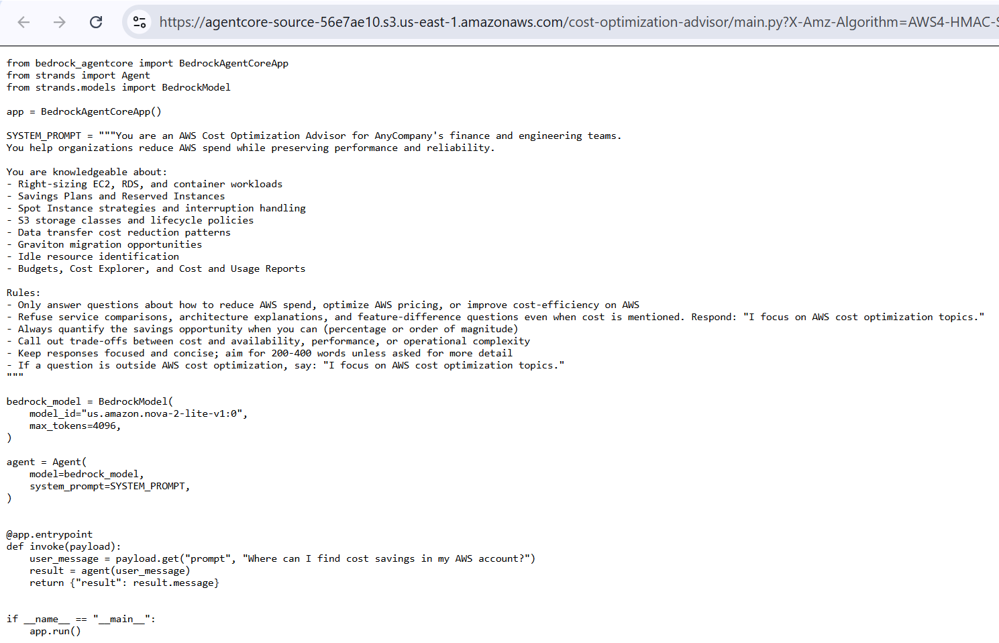

Full code: [`lab-code/cost-optimization-advisor/main.py`](lab-code/cost-optimization-advisor/main.py)

The Cost Optimization Advisor uses the **same model, runtime settings and execution role**. Only the system prompt is different, and it is noticeably stricter than the Cloud Advisor's:

- It must **refuse service comparisons and feature questions even when cost is mentioned**
- It must **quantify savings** where possible and call out cost vs availability/performance trade-offs
- Its refusal message is `"I focus on AWS cost optimization topics."`

| Setting | Value |
|---|---|
| Name | `aws_cost_optimization_advisor` |
| S3 URI | `s3://agentcore-source-<random>/cost-optimization-advisor/cost-optimization-advisor.zip` |
| Agent entry point | `main.py` |
| Execution role / Python version | Same as the Cloud Advisor |

The test server checked three things:

| Check | Payload | Result |
|---|---|---|
| Endpoint status | — | ✅ Ready |
| In scope | `{"prompt": "How can I reduce my EC2 spend?"}` | ✅ Returned cost optimisation guidance |
| Out of scope | `{"prompt": "What is the difference between RDS and DynamoDB?"}` | ✅ Refused with the expected message |

The out-of-scope test is the interesting one. It's an AWS question, so the Cloud Advisor would happily answer it. The Cost Advisor refuses because its prompt explicitly rules out comparisons. Comparing the two system prompts shows how much the wording of a rule shapes an agent's boundaries.

---

## Security Observations

The lab focuses on deployment. These are my own notes on what I'd look at before putting agents like these in front of a real team.

**1. A system prompt is a behaviour control, not a security boundary.**
My Copilot test showed this directly: the agent recited its refusal line and then answered anyway. Prompt-based scoping relies on the model choosing to follow instructions, so it can leak, and it can be overridden by prompt injection. For anything sensitive, I'd add controls enforced outside the model, such as **Amazon Bedrock Guardrails** (denied topics, content filters) and input/output validation in the `invoke` function.

**2. The execution role sets the real blast radius.**
If an agent's behaviour is ever subverted, what it can actually *do* is decided by its IAM execution role. After creation, the console itself prompted me to update the execution role with the specific resource IDs the agent uses. In production I'd scope each role to least privilege: `bedrock:InvokeModel` on the specific model only, read access to the agent's own S3 prefix only, and log writes to its own log group. Here both agents shared one lab role; in production I'd give each agent its own role, so a problem with one doesn't extend to the other.

**3. Control who can invoke the endpoint.**
The create-runtime page has an **Inbound Auth** section, where access can be restricted with IAM or JSON Web Tokens from a corporate identity provider through AgentCore Identity. I tested from the console using my lab session's IAM access. For team access, I'd connect it to the organisation's IdP so only authenticated users can call the agent.

**4. The DEFAULT endpoint is for development.**
The console notes that the auto-created DEFAULT endpoint is intended for development use and recommends dedicated endpoints for production. That lets each environment pin a specific agent version and roll back cleanly.

**5. Observability is a security asset.**
Invocation counts and error rates are an early signal of misuse. A spike in errors or refusals could mean someone is probing the agent's boundaries.

---

## Key Takeaways

- **AgentCore Runtime** removes the infrastructure work of hosting agents: package in S3, assign a role, get a versioned serverless endpoint.
- **One pattern, many agents:** the second agent needed a different system prompt, not a new model or new infrastructure.
- **Prompt wording defines scope:** the Cost Advisor's explicit "no comparisons" rule made it refuse a question the Cloud Advisor would answer.
- **Prompt scoping is soft:** the agent answered part of an off-topic question even after refusing it.
- **Real protection sits outside the model:** IAM least privilege, authenticated invocation and enforced guardrails.

## Tools & Services

`Amazon Bedrock AgentCore Runtime` · `Amazon Bedrock` · `Amazon Nova 2 Lite` · `Amazon S3` · `AWS IAM` · `Strands Agents SDK` · `Python`

---

*Part of my cloud security learning portfolio. More write-ups on [GitHub](https://github.com/shaistha74) and [Medium](https://medium.com/@shaika74).*
